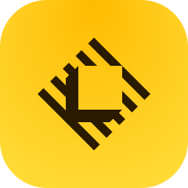
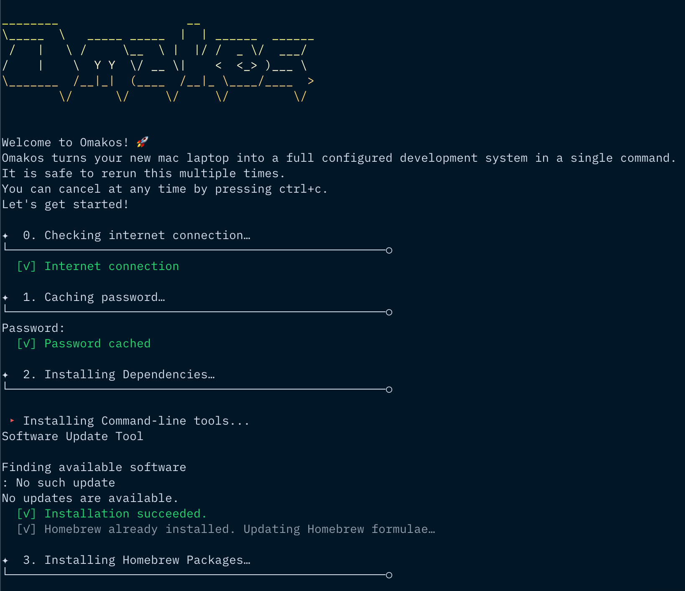

# Omakos

> Omakos turns your macOS laptop into a fully functional development machine in a single command.
> A shell script to setup a new mac.

Omakos is inspired by Basecamp's [Omakub](https://github.com/basecamp/omakub) project. The name is a combination of "omakase" (お任せ, Japanese for "I leave it up to you") and "macOS", reflecting its purpose of providing a curated development environment setup for macOS.

It can be run multiple times on the same machine safely.
It installs, upgrades, or skips packages based on what is already installed on the machine.



## Install

You can install Omakos using one of these two methods:

### Option 1: Direct Install (Recommended)

Run this single command in your terminal:

```sh
curl -L https://raw.githubusercontent.com/yatish27/omakos/main/install.sh | bash
```

Run this from an interactive terminal. The installer downloads and validates the
archive before replacing `~/omakos`. If that path already exists, its contents
(including Git history and local changes) are preserved in a unique
`~/omakos.backup.*/omakos` directory printed during installation.

### Option 2: Manual Install

If you prefer to review the code first:

1. Download the repo:

```sh
git clone https://github.com/yatish27/omakos.git && cd omakos
```

2. Review the scripts (please don't run scripts you don't understand):

```sh
less setup.sh
```

3. Run the setup:

```sh
./setup.sh 2>&1 | tee ~/omakos.log
```

Just follow the prompts and you'll be fine. 👌

## What it sets up

The setup process will install and configure the following tools and applications.
Homebrew packages are defined in [`configs/Brewfile`](configs/Brewfile).
Safari extensions are installed from the Mac App Store by [`scripts/safari-extensions.sh`](scripts/safari-extensions.sh).

### Command Line Tools

- [XCode Command Line Tools](https://developer.apple.com/xcode/downloads/) for developer essentials
- [Git](https://git-scm.com/) for version control
- [Homebrew](http://brew.sh/) for managing operating system libraries
- [ZSH](https://www.zsh.org/) with [Oh My Zsh](https://ohmyz.sh/) for a better shell experience
- [coreutils](https://www.gnu.org/software/coreutils/) for GNU file, shell and text manipulation utilities
- [curl](https://curl.se/) and [wget](https://www.gnu.org/software/wget/) for downloading files
- [fzf](https://github.com/junegunn/fzf) for command-line fuzzy finding
- [jq](https://stedolan.github.io/jq/) for JSON processing
- [btop](https://github.com/aristocratos/btop) for system resource monitoring
- [fastfetch](https://github.com/fastfetch-cli/fastfetch) for system information display
- [ffmpeg](https://ffmpeg.org/) for video processing
- [gh](https://cli.github.com/) for GitHub CLI integration
- [1Password CLI](https://developer.1password.com/docs/cli/) (`op`) for command-line access to 1Password
- [mas](https://github.com/mas-cli/mas) for installing Mac App Store apps
- [libyaml](https://pyyaml.org/wiki/LibYAML) for YAML parsing

### Development Environment

- [Zed](https://zed.dev/) - High-performance code editor
- [cmux](https://www.cmux.dev/) - Terminal with the existing Ghostty colors and Google Sans Code font settings
- [Bruno](https://www.usebruno.com/) - API client
- [Elixir](https://elixir-lang.org/) with Erlang for Elixir/EEx/HEEx language support
- [Docker](https://www.docker.com/) for containerization
- [OrbStack](https://orbstack.dev/) for Docker and Linux development on macOS
- [PostgreSQL 18](https://www.postgresql.org/) with `libpq` for database management
- [Redis](https://redis.io/) for in-memory data store
- [jemalloc](https://jemalloc.net/) for memory allocation
- [vips](https://www.libvips.org/) for image processing (automatically installs configured runtimes if `~/.mise.toml` exists)
- [Ollama](https://ollama.ai/) for local AI models
- [Overmind](https://github.com/DarthSim/overmind) for process management
- [Mise](https://mise.jdx.dev/) for runtime version management. The Mise configuration is present in [mise.toml](configs/mise.toml). It installs
  - Python
  - Ruby
  - Rust
  - Go
  - Node
- [UV](https://github.com/astral-sh/uv) for Python packaging
- [pnpm](https://pnpm.io/) for Node.js package management

### Productivity & Communication

- [1Password](https://1password.com/) for password management
- [ChatGPT](https://chat.openai.com/) for AI assistance
- [Claude](https://claude.ai/) for AI assistance
- [Codex](https://openai.com/codex/) for agentic coding assistance
- [Copilot Money](https://www.copilot.money/) for tracking spending, budgets, and investments
- [Discord](https://discord.com/) for communication
- [IINA](https://iina.io/) for media playback
- [LocalSend](https://localsend.org/) for cross-platform file sharing
- [NetNewsWire](https://netnewswire.com/) for RSS reading
- [NordVPN](https://nordvpn.com/) for VPN connectivity
- [Obsidian](https://obsidian.md/) for note-taking
- [Mole](https://github.com/tw93/Mole) for Mac maintenance and cleaning
- [Sol](https://github.com/ospfranco/sol) for the Command-Space launcher, with launch at login
- [Rectangle](https://rectangleapp.com/) for window management
- [Slack](https://slack.com/) for team communication
- [OpenSuperWhisper](https://github.com/my-monkeys/homebrew-tap) for voice transcription, installed from `my-monkeys/tap/opensuperwhisper`
- [Ungoogled Chromium](https://ungoogled-software.github.io/) for privacy-focused Chromium browsing
- [WhatsApp](https://www.whatsapp.com/) for messaging
- [Zoom](https://zoom.us/) for video conferencing

### Safari Extensions

- [1Password for Safari](https://apps.apple.com/app/id1569813296) for passwords and autofill (free download; requires a 1Password account)
- [Consent-O-Matic](https://apps.apple.com/app/id1606897889) for automatically answering cookie consent popups using your preferences (free and open source)
- [Wipr 2](https://apps.apple.com/app/id1662217862) for blocking ads and trackers (paid; purchase in the App Store before setup)

Sign in to the Mac App Store before setup and approve authentication prompts for
the downloads. If installation fails, setup continues and prints a retry command.
Wipr 2 is installed using an existing purchase; setup cannot buy it for you.
After installation, enable 1Password and Consent-O-Matic in **Safari > Settings > Extensions**
and approve their website access. Choose your cookie preferences in Consent-O-Matic.
Open Wipr 2 and follow its setup instructions to enable its Safari extensions.

### Fonts

- Cascadia Code
- Cascadia Mono
- Commit Mono
- DM Sans
- Fira Code
- Geist
- Geist Mono
- Google Sans Code
- Hack
- IBM Plex Mono
- IBM Plex Sans
- Work Sans

### Enhanced macOS Settings

The setup applies developer-optimized macOS configurations including:

- **Performance**: Reduce Motion enabled, near-instant window animations, and faster Mission Control
- **Finder**: Opens to home directory, searches current folder by default, shows hidden files
- **Text Editing**: Key repeat enabled in all apps, faster cursor movement
- **Screenshots**: Organized in `~/Desktop/Screenshots/` folder without shadows
- **Trackpad**: Single-tap clicking on built-in and Bluetooth trackpads, plus three-finger drag
- **Keyboard**: Fastest repeat rates for efficient coding
- **Launcher**: Command-Space opens Sol; Spotlight's keyboard shortcuts are disabled while file indexing remains available
- **Window Snapping**: Rectangle snapping enabled; native edge-drag, menu-bar-drag, and Option-drag tiling disabled
- **Appearance**: Reduce Transparency enabled and cmux fully opaque with no background blur
- **Safari**: Website tinting and notification permission prompts disabled; video autoplay defaults to Never Auto-Play, preserving website exceptions
- **Widgets**: Hidden on the desktop and in Stage Manager; Safari start-page sections hidden with empty new tabs/windows
- **System**: Disabled automatic corrections, expanded dialogs, local saves by default

## Features

### Modular Scripts

Each script in the [`scripts/`](scripts/) directory can be run independently:

```sh
# Run individual scripts
./scripts/mac.sh       # Only configure macOS settings
./scripts/safari-extensions.sh # Install Safari extensions from the Mac App Store
./scripts/git.sh       # Only setup Git configuration
./scripts/zed.sh       # Only configure Zed editor
./scripts/cmux.sh      # Only configure cmux's terminal appearance
./scripts/sol.sh       # Configure Sol and replace Spotlight's keyboard shortcuts
./scripts/mise.sh      # Only setup mise and install configured runtimes
./scripts/rubocop.sh   # Only setup Rubocop configuration
./scripts/gemrc.sh     # Only setup Gem configuration
./scripts/irbrc.sh     # Only setup IRB configuration
./scripts/zshrc.sh     # Only setup Zsh configuration
./scripts/ssh.sh       # Only configure SSH settings
```

The scripts are designed to be:

- **Independent**: Each script can run on its own
- **Idempotent**: Safe to run multiple times
- **Configurable**: Easy to modify for your needs

## Code Structure

The project follows a modular structure where each component is responsible for a specific setup task. You can run any script individually if you only want to set up specific parts of your system.

```
omakos/
├── setup.sh                 # Main setup script
├── scripts/
│   ├── ascii.sh            # ASCII art for terminal output
│   ├── brew.sh             # Homebrew package installation
│   ├── cmux.sh             # cmux terminal configuration
│   ├── gemrc.sh            # Gem configuration
│   ├── git.sh              # Git configuration
│   ├── irbrc.sh            # IRB configuration
│   ├── mac.sh              # macOS system preferences
│   ├── mise.sh             # Mise runtime manager setup
│   ├── rubocop.sh          # Rubocop configuration
│   ├── safari-extensions.sh # Safari extension installation via the Mac App Store
│   ├── sol.sh              # Sol launcher and Command-Space shortcut
│   ├── ssh.sh              # SSH configuration
│   ├── utils.sh            # Utility functions
│   ├── zed.sh              # Zed editor configuration
│   ├── zsh.sh              # ZSH shell setup
│   └── zshrc.sh            # Zshrc configuration
├── configs/
│   ├── Brewfile            # Homebrew packages list
│   ├── cmux.conf           # cmux terminal appearance (Ghostty syntax)
│   ├── git/                # Git configuration files
│   ├── sol/                # Sol launcher settings
│   ├── ssh/                # SSH configuration files
│   ├── zed/                # Zed editor settings
│   ├── gemrc              # Ruby gems configuration
│   ├── irbrc              # IRB (Interactive Ruby) configuration
│   ├── mise.toml          # Mise runtime versions config
│   ├── rubocop.yml        # Ruby code style config
│   └── zshrc              # Zsh shell configuration
└── README.md
```

### Configuration Files

The [`configs/`](configs/) directory contains all config files.

Zed automatically installs the GitHub Dark Default theme and the Ruby, HTML, and
Elixir extensions. When you first open a matching file, Zed downloads the required
language servers: Ruby LSP and RuboCop, Herb for HTML+ERB, TypeScript Language Server
and ESLint, HTML/CSS and Tailwind CSS servers, and ElixirLS. Ruby and Node come from
mise; Elixir and Erlang come from Homebrew. Formatting uses Zed-managed RuboCop,
Herb, and Prettier. Projects still need their own dependencies and ESLint/Tailwind
configuration. See [Zed's language-server management](https://zed.dev/docs/configuring-languages#managing-language-servers).

cmux receives [`configs/cmux.conf`](configs/cmux.conf) at
`~/Library/Application Support/com.cmuxterm.app/config.ghostty`, its
[documented app-specific configuration path](https://github.com/manaflow-ai/cmux/blob/main/docs/customizing-appearance.md).
It preserves the previous Ghostty palette, cursor, ligatures, and Google Sans Code
Light 14 font with compact spacing (also used in the former iTerm2 profile).
Existing shared Ghostty files remain untouched. Reload cmux's configuration with
Command-Shift-comma after changing it.

### Installation regression checks

Run `python3 -m unittest discover -s tests -v`. These checks use temporary home
directories and mock downloads, package installation, and system changes.

## Customization

The script is designed to be customizable. You can:

- Modify the [`Brewfile`](configs/Brewfile) to add/remove packages
- Adjust macOS settings in [`scripts/mac.sh`](scripts/mac.sh)
- Modify the configuration files in [`configs/`](configs/) directory


## License

This project is licensed under the MIT License - see the [LICENSE](LICENSE) file for details.

## Acknowledgements

Inspiration and code was taken from many sources, including:

- [Formation](https://github.com/minamarkham/formation) by Mina Markham
- [Omakub](https://github.com/basecamp/omakub)
